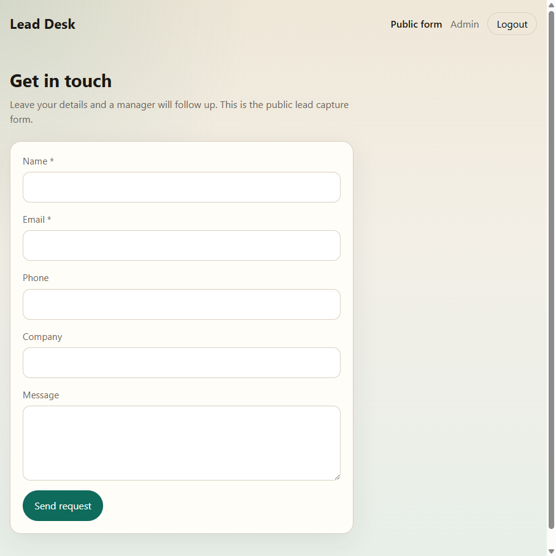
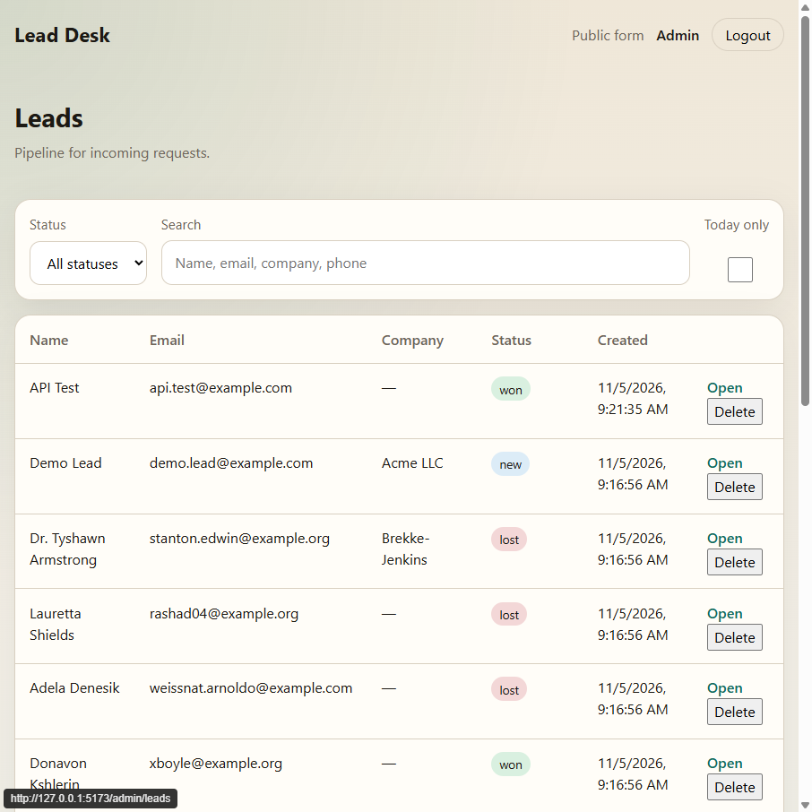
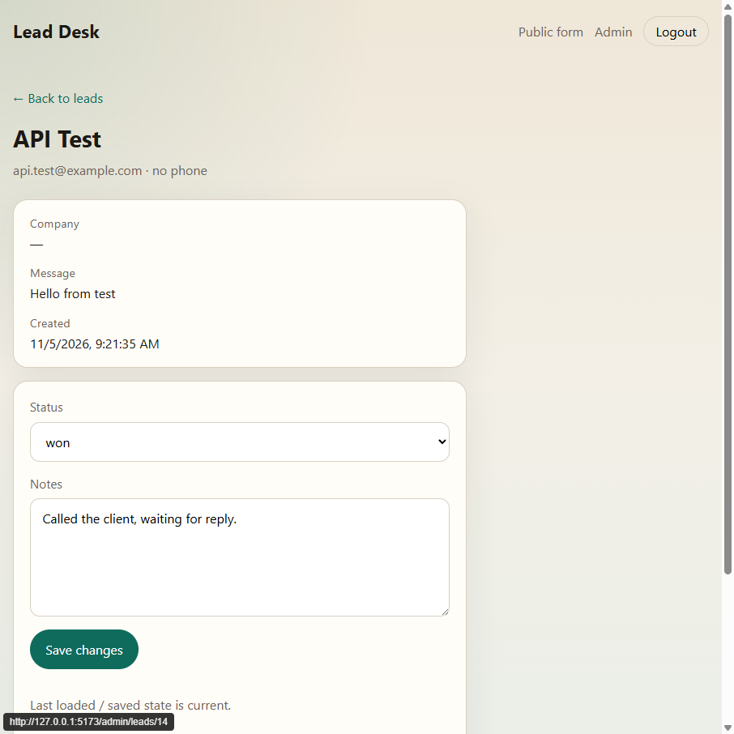

# Lead Desk

Vue 3 + Laravel REST mini-CRM for capturing and managing leads.

Public visitors submit a contact form. Managers sign in and work the pipeline: statuses, notes, search, and filters.

## Stack

- **Backend:** Laravel 13, Sanctum (SPA cookie auth), Eloquent, Form Requests, API Resources, SQLite
- **Frontend:** Vue 3, Vite, Vue Router, Pinia, Axios
- **Auth:** Laravel Sanctum stateful SPA authentication

## Features

- Public lead capture form with validation errors
- Manager login / logout
- Leads list with status filter, search, today filter, and pagination
- Lead detail: change status (`new`, `in_progress`, `won`, `lost`) and notes
- Quick actions: Mark as won / Mark as lost
- Delete lead from detail page and from the list (with confirm)

## Screenshots

### Public lead form



### Admin leads pipeline



### Lead detail



## Demo credentials

After seeding:

- Email: `manager@leaddesk.test`
- Password: `password`

## Tests

```bash
php artisan test --filter=LeadApiTest
```

Feature coverage:
- public create lead + validation
- guest cannot list leads
- authenticated list / status filter / today filter
- login success and failure

## Requirements

- PHP 8.3+ (Laragon recommended on Windows)
- Composer
- Node.js 20+
- Extensions: openssl, pdo_sqlite, mbstring, tokenizer, xml, ctype, json, fileinfo, curl

## Setup

```bash
# Backend
cd lead-desk
composer install
copy .env.example .env   # Windows
php artisan key:generate
# ensure database/database.sqlite exists
type nul > database\database.sqlite
php artisan migrate --seed

# Frontend
cd frontend
npm install
```

## Run locally

Use two terminals:

```bash
# Terminal 1 — API
cd lead-desk
php artisan serve
```

```bash
# Terminal 2 — Vue (proxies /api and /sanctum to :8000)
cd lead-desk/frontend
npm run dev
```

Open [http://127.0.0.1:5173](http://127.0.0.1:5173) (keep using `127.0.0.1` or `localhost` consistently so Sanctum cookies work).

### Windows / Laragon tip

If `php` is not in PATH:

```powershell
$env:Path = "C:\laragon\bin\php\php-8.3.30-Win32-vs16-x64;C:\laragon\bin\composer;" + $env:Path
```

## API overview

| Method | Endpoint | Auth | Description |
|--------|----------|------|-------------|
| POST | `/api/leads` | public | Create lead |
| POST | `/api/login` | public | Login |
| POST | `/api/logout` | sanctum | Logout |
| GET | `/api/user` | sanctum | Current user |
| GET | `/api/leads` | sanctum | List/filter leads |
| GET | `/api/leads/{id}` | sanctum | Show lead |
| PATCH | `/api/leads/{id}` | sanctum | Update status/notes |
| DELETE | `/api/leads/{id}` | sanctum | Delete lead |

## Project structure

```
lead-desk/
  app/Http/Controllers/Api/
  app/Http/Requests/
  app/Http/Resources/
  app/Models/Lead.php
  routes/api.php
  frontend/
    src/pages/
    src/stores/
    src/api/
```

## Why this project

Built as a portfolio bridge from WordPress full-stack work (AJAX forms, CRM integrations, admin workflows) to Vue + Laravel.
